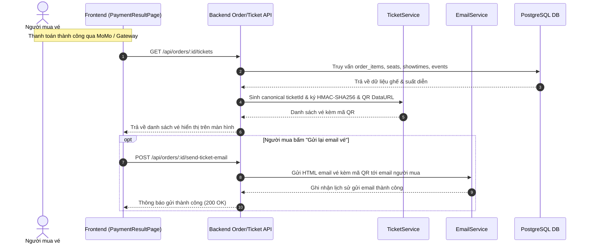

# SCRUM-223 [S-27] & SCRUM-35 [E-11]: Vé gửi qua email kèm mã QR

- **Story:** `[S-27]` Vé gửi qua email kèm mã QR (SCRUM-223)
- **Epic:** `[E-11]` Public Event Pages, Sales Controls & Notifications / Trang công khai, mở bán và thông báo (SCRUM-35)
- **Người thực hiện:** Cao Long (CL)
- **Story Points:** 2
- **Trạng thái:** Hoàn thành (Backend, Frontend, Tests & Documentation)

---

## 1. Mục tiêu và Phạm vi

Sau khi đơn hàng được thanh toán thành công (hoặc khi người mua yêu cầu gửi lại), hệ thống tự động phát hành vé điện tử kèm mã QR có chữ ký số bảo mật và gửi trực tiếp qua email của người mua vé.

Story này hoàn thiện phân hệ **Notifications (Thông báo)** trong **Epic E-11: Public Event Pages, Sales Controls & Notifications**, khép lại toàn bộ vòng đời trải nghiệm từ khi xem sự kiện công khai (S-08), chọn ghế trên sơ đồ (S-09), mở/đóng bán của ban tổ chức (S-07), đến khi thanh toán và nhận vé qua email (S-27).

---

## 2. Tiêu chí Chấp nhận (Acceptance Criteria)

- **AC1:** Sau khi đơn hàng được thanh toán thành công (`status = 'paid'`), hệ thống tự động gửi email xác nhận vé đến địa chỉ email của người mua.
- **AC2:** Email vé điện tử chứa đầy đủ thông tin:
  - Tên sự kiện (`event.title`), địa điểm (`event.venue`), thời gian suất diễn (`showtime.starts_at`).
  - Mã đơn hàng (`order.id`), tổng tiền thanh toán.
  - Danh sách ghế đã mua (hàng ghế, số ghế, hạng vé, giá vé).
  - Ảnh mã QR cho từng vé (định dạng Data URL base64 PNG hoặc SVG) hiển thị trực quan trong email.
- **AC3:** Mã QR trên vé được ký số bằng thuật toán **HMAC-SHA256**:
  - Chuỗi định danh: `ticketId:orderId:showtimeId:seatId:seatLabel`.
  - Chống mọi hành vi can thiệp, sửa đổi số ghế, đổi suất diễn hoặc tạo mã QR giả ngoài hệ thống.
  - Mỗi mã vé có định danh chuẩn: `TKT-<8 ký tự order>-<seatId>`.
- **AC4:** Hệ thống cung cấp API cho phép người mua (chủ đơn hàng) hoặc Admin yêu cầu gửi lại email vé khi cần thiết (`POST /api/orders/:orderId/send-ticket-email`).
- **AC5:** Giao diện kết quả thanh toán (`/payment-result` và `/payment/return`) hiển thị thông báo đã gửi email vé, hiển thị trực quan vé và mã QR trên màn hình, kèm nút bấm **"Gửi lại email vé"** thao tác thuận tiện.
- **AC6:** Toàn bộ test suite tự động kiểm thử chữ ký, sinh mã QR, dịch vụ gửi email và bảo mật API đạt 100% pass (13/13 tests passed, 0 lint warnings).

---

## 3. Kiến trúc và Luồng Xử lý



---

## 4. Danh sách API Endpoints

### 1. Lấy danh sách vé kèm mã QR của đơn hàng
- **Method:** `GET`
- **Path:** `/api/orders/:orderId/tickets` (hoặc `/api/payments/orders/:orderId/tickets`)
- **Headers:** `Authorization: Bearer <token>`
- **Quyền hạn:** Chủ đơn hàng hoặc `admin`
- **Response (200 OK):**
```json
{
  "success": true,
  "data": {
    "orderId": "e7b8c9d0-1234-5678-90ab-cdef12345678",
    "status": "paid",
    "totalAmount": 700000,
    "currency": "VND",
    "ticketCount": 2,
    "tickets": [
      {
        "ticketId": "TKT-E7B8C9D0-101",
        "orderId": "e7b8c9d0-1234-5678-90ab-cdef12345678",
        "seatLabel": "A1",
        "categoryName": "VIP",
        "unitPrice": 350000,
        "showtimeId": 12,
        "startsAt": "2026-11-20T20:00:00.000Z",
        "eventTitle": "Hòa nhạc Symphony Mùa Thu 2026",
        "eventVenue": "Nhà hát Lớn Hà Nội",
        "signature": "3f82b...",
        "qrCodeDataUrl": "data:image/png;base64,iVBORw0KGgo...",
        "qrPayload": "{\"t\":\"TKT-E7B8C9D0-101\",\"seat\":\"A1\",\"sig\":\"3f82b...\"}"
      }
    ]
  }
}
```

### 2. Gửi / Gửi lại email vé điện tử
- **Method:** `POST`
- **Path:** `/api/orders/:orderId/send-ticket-email` (hoặc `/api/orders/:orderId/resend-ticket`)
- **Headers:** `Authorization: Bearer <token>`
- **Response (200 OK):**
```json
{
  "success": true,
  "message": "Vé điện tử kèm mã QR đã được gửi về email thành công.",
  "data": {
    "orderId": "e7b8c9d0-1234-5678-90ab-cdef12345678",
    "recipientEmail": "buyer@test.com",
    "ticketCount": 2,
    "sentAt": "2026-10-21T15:45:00.000Z"
  }
}
```

---

## 5. Hướng dẫn Kiểm thử

```bash
# 1. Chạy bộ kiểm thử tự động S-27
cd backend
npx jest tests/ticketEmailS27.test.js --runInBand --coverage=false

# 2. Kiểm tra lint mã nguồn backend & frontend
cd backend && npm run lint
cd ../frontend && npm run lint

# 3. Biên dịch hệ thống
cd backend && npm run build
cd ../frontend && npm run build
```
